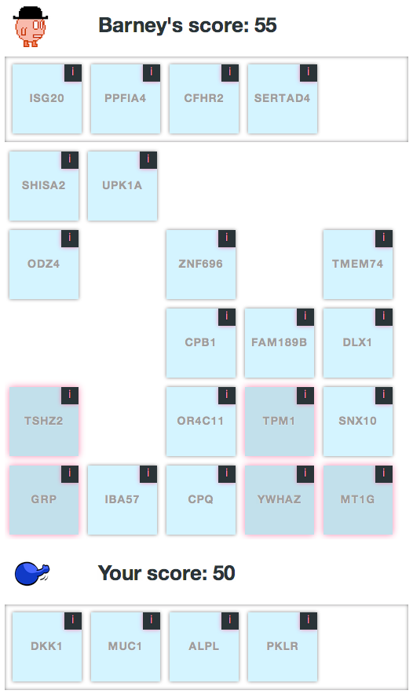
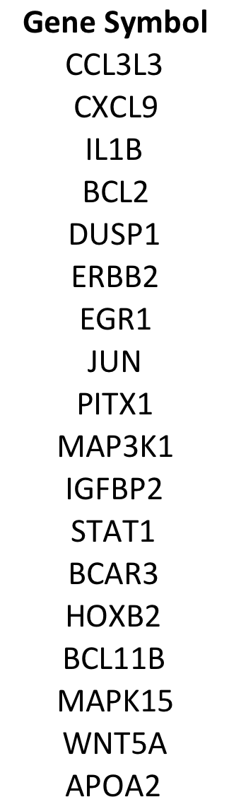

# Research Strategy: Approach

**Preliminary Data.** We recently released a game called 'The Cure' with the specific purpose of building predictors of breast cancer survival time based on gene expression and copy number variation (CNV) (http://genegames.org/cure/). In this game the player competes with a computer opponent to select the highest scoring set of five genes from a board containing 25 different genes. Figure 1 illustrates a game in progress. Each player's score is determined by using labeled training data to infer and test decision tree classifiers that predict survival time using expression and CNV data from just the selected genes. The better the gene set performs in generating predictive decision trees, the higher the score. When the player defeats their opponent, they move on to play another board. (Multiple players play each board.) Extensive information from the Gene Ontology, RefSeq, Entrez Gene and PubMed is provided through the game interface to aid players in selecting their genes. Players are also free to make use of external knowledge sources.

This game was first promoted via a presentation at the Genome Informatics 2012 conference. In the first week following (Sept. 7-14, 2012), more than 120 players registered and collectively played more than 2000 games. Based on a brief survey taken during registration, nearly half of the players self-reported having PhDs and half claimed knowledge of cancer biology.

**Figure 1. A round of The Cure** (`figures/figure-1-the-cure-round.png`)

We ranked each gene according to the ratio of the number of times that it was selected by different players to the number of times that it appeared in any played game. Genes with selection frequencies greater than or equal to 80% from players that declared knowledge of cancer are depicted in Figure 2. Using the top 10 genes, we were able to generate decision tree predictors of 10-year survival with an accuracy of 65% in 10-fold cross-validation - substantially better than classifiers produced using randomly selected genes (55%). Using an exhaustive search through the top 10 genes, we found 10 different unique gene combinations that, when aggregated, produced statistically significant (FDR < 0.05) indicators of survival within: (1) the training dataset used in the game, (2) a validation cohort from the same study, and (3) an independent validation set from a completely different study.

The twenty genes listed in Figure 2 were included in a predictor submitted to the SAGE Breast Cancer Prognosis challenge (http://tinyurl.com/sage-bcc). The predictor scored 69% correct on survival concordance index in an external test dataset, just 3% behind the best submitted predictor and significantly above the median of hundreds of submitted models. The results from The Cure showed clearly that biologists with knowledge that is relevant to cancer biology will play scientific games, and that combined with even basic analytical techniques, meaningful knowledge for inferring predictors of disease progression can be extracted and applied.

**Figure 2. Genes selected by game players** (`figures/figure-2-genes-selected.png`). The figure is a single column headed "Gene Symbol": CCL3L3, CXCL9, IL1B, BCL2, DUSP1, ERBB2, EGR1, JUN, PITX1, MAP3K1, IGFBP2, STAT1, BCAR3, HOXB2, BCL11B, MAPK15, WNT5A, APOA2.

## Specific Aim #1: Implement a serious game for building predictors of breast cancer progression.

**Introduction.** No amount of raw genomic data will produce accurate, reproducible indicators of disease state without being focused by the lens of biological knowledge. With the research literature growing at a pace exceeding 1 million articles per year, current strategies for harnessing this knowledge are insufficient. The objective of this aim is to create an innovative system that will provide both the incentive and the means for biologists to rapidly share their knowledge and their intuition in a computable form. To attain this objective, we will test the hypothesis that enjoyable serious games can enable us to extract biological insights from breast cancer experts through game play. The rationale for this aim is that successful completion of the proposed research will contribute a fundamentally new, powerful method for knowledge acquisition that has the potential to dramatically expand the diversity and depth of human insight that can be applied to the inference of disease predictors. When the proposed studies for this aim have been completed, it is our expectation that we will arrive at a reproducible, scalable social and technical pattern for capturing computable biological wisdom directly from biologists. Such a finding would be of importance, because it would not only allow us to develop better predictors of breast cancer progression but also because it would establish a fundamentally new paradigm for knowledge acquisition in the life sciences that scales with the rate of knowledge being generated.

**Justification and feasibility.** Serious games or "games with a purpose" are a new form of crowdsourcing that explicitly employs fun as a primary incentive for volunteer participation [9]. While these games began as systems for collecting common-sense knowledge [10, 11], they have recently been used to help solve complex biological problems. The most successful example is Foldit (http://fold.it), a game that has recruited more than 300,000 players and solved an impressive string of challenges in computational protein folding [12-14]. Of the Foldit player's many achievements, perhaps the most notable is the design of a new protein folding algorithm with competitive performance to recent professionally-created solutions [15]. Building on this success, the EteRNA game (http://eterna.cmu.edu/) allows players to design RNA molecules that will fold to specified three-dimensional structures. EteRNA has more than 38,000 registered players, some of whom have already made significant advances in the domain of RNA structure design [16]. In yet another successful biological game, Phylo has attracted more than 12,000 players that have improved upon very large multiple sequence alignments [17]. Foldit, EteRNA and Phylo have demonstrated that many people are interested in playing serious, biological games and that these games can result in tangible contributions to important biological challenges.

The scientific games in this proposal are different from these early examples in that they are not targeted to a completely general audience. We are seeking players that have biological knowledge or are willing to acquire that knowledge in order to succeed at the game. Based on the results from the feasibility study presented in Preliminary Data, we are confident that such players can be recruited. In addition, while all serious games emphasize fun as the primary motivator, other incentives exist that are particularly relevant to our target audience. First, many people will play simply because they desire to help cure breast cancer. This is a straightforward and potentially very powerful motivator. Second, many will play for the learning opportunities that the games will afford. As 'shenyijie', one of the most active players of The Cure (see Preliminary Data), stated when asked why he played for more than 20 hours over the course of a few days, "This is a wonderful game, which can give me happiness and knowledge at the same time." We will test the assumption that we can find and motivate many more players like shenyijie according to the following research design.

**Research Design.** The game that is the subject of this specific aim will build from The Cure prototype discussed in Preliminary Data. It will provide an entertaining experience that connects players directly with genomic datasets related to breast cancer. It will be developed in the following phases:

*Phase 1: Game design.* We will begin work on game development with the biological objective of identifying specific sets of genes that can be used to make predictors of breast cancer progression based on RNA expression levels in tumor samples. To begin development we will start with the general game structure used in The Cure (Preliminary Data) which is modeled after a card game. Importantly, we will extend this design with embedded challenges with known answers that we can use to judge player proficiency. The design of the core game mechanic will be refined through consultation with professional game designers (see letter of support from Josh Peay) and an iterative, user-centered design process. Prior to development, mockups of game prototypes will be rapidly created and tested in focused user-group studies. Once we arrive at a game structure that is consistently considered fun by our test subjects, we will implement the game and deploy it to our website for further testing. Again, we will enter a highly iterative design process to ensure that the game consistently delivers enjoyment while accumulating useful, quantifiable data.

*Phase 2: Broad deployment and promotion.* When the Web-version of the game meets our expectations for playability and knowledge acquisition in controlled tests, we will utilize a variety of resources at our disposal to attract players. In particular, we will leverage the BioGPS website to directly solicit players via postings on the home page (which is viewed 2 million times per year by more than 125,000 unique visitors) and direct emails to the more than 5,000 registered users [18]. In addition, we will exchange Web links with the websites associated with Foldit and EteRNA and expand our use of social networking websites and blogs. Finally we will partner with conferences for breast cancer research to incorporate contests involving our game directly into conference agendas [19].

*Phase 3: Player evaluation.* We will evaluate the game in terms of the number of distinct players, the amount of time spent playing per player, the number of games played and player demographics including age, sex, occupation, and education. In addition to these statistics on the player population and the raw amount of game play, we will make use of the embedded test questions mentioned in Phase 1 to ascertain the level of expertise possessed by each player. These data will allow us to answer the question of whether or not and to what degree we are reaching and engaging the target audience for the game.

**Expected Outcomes.** When the proposed studies for this aim have been completed, it is our expectation that we will have produced a successful game for capturing computable biological wisdom about breast cancer directly from biologists. Specifically, we will have generated a website where participants can play a game that is focused on inferring predictors of breast cancer progression based on RNA expression data. In addition, we will have gathered extensive information about the demographics and basic skill levels of the population that is interested in playing serious biological games.

**Potential problems and alternative strategies.** A clear danger in any crowdsourcing initiative is the mentality that 'if you build it, they will come'. If no one ends up playing this game, the value from this project will be minimal; however, based on our preliminary studies, access to the BioGPS user-base and the success of other biological games, we feel strongly that this event is very unlikely. A more realistic concern is that many players will arrive at the game initially but then quickly lose interest. Indeed, in preliminary studies this effect was observed with the majority of game-play happening quickly after launch. Because of the extensive effort that will go into the design of the game-mechanic in Phase 1, we feel that our chances of making a compelling and 'sticky' game are very good. In the unlikely event that we do observe significant player decline after the initial excitement, we will focus efforts on generating a series of prize-driven competitions to repeatedly prime the interest of players. More importantly, interest in game play will likely be driven in part by interest in the specific disease upon which the game will focus. The software written to implement the game will facilitate the release of 'reskinned' versions of the game that tackle similar problems in other disease areas. Indeed, we already intend to deploy a second version of this game to focus on defining predictors of organ transplant rejection (see letter of support from Dan Salomon).

## Specific Aim #2: Create a computational framework that integrates data from games with data from biological experiments to infer genomic predictors of breast cancer progression.

**Introduction.** The nature of the knowledge captured through serious games and other forms of crowdsourcing has fundamental differences with the knowledge sources used in prior studies. The objective of this aim is to implement algorithms that translate biological knowledge captured through our game into measurable advances in the accuracy of predictive models of breast cancer progression. To attain this objective, we will test the working hypotheses that factors pertaining to participant's abilities can be detected and used to weight the quality of each data point, that aggregation strategies such as voting can be used to compute confidence estimates in assertions made by the community and that these assertions can be used to enhance predictive models inferred directly from experimental measurements of biological samples. The rationale for this aim is that successful completion of the proposed research will provide the tools necessary to compute effectively with the data generated by the game, thus making it feasible to take advantage of it to build predictive models of breast cancer progression. When the proposed studies for this aim have been completed, it is our expectation that we will have generated the capacity to accurately quantify levels of trust for both the participants in our game and their contributions of knowledge. These algorithms and the associated open-source software would be of importance because they would allow, for the first time, the development of hybrid systems for predicting disease progression, and potentially many other biological phenotypes, that benefit from both the wisdom of the crowd and from the patterns that can be extracted directly from experimental data.

**Justification and Feasibility.** Existing computational approaches that integrate prior knowledge into the process of inferring predictors of disease progression focus on the use of large, typically general purpose, databases that are either professionally curated (e.g. Reactome, Gene Ontology) or the direct output of high-throughput experiments (e.g. protein interaction networks). Many technical approaches now exist that use these databases to help infer expression-based cancer predictors with improved performance [5, 8, 20]. While such studies demonstrate some of the potential value of integrating knowledge into the process of inferring cancer predictors, the methods cannot be applied directly to the output of biological games for several reasons. Most importantly, the knowledge that will be collected will arrive from many different sources (players) and each will vary greatly in their level of expertise. As a result, systems need to be put in place that can appropriately weight the quality of each contribution and integrate these contributions into a coherent whole.

A large number of crowdsourcing applications distribute discrete units of work, e.g. image labeling, to many different contributors that are paid per unit of work through systems like Amazon's Mechanical Turk, enticed to complete the tasks as elements of games [9, 21] or forced to complete the tasks as part of Web security protocols [22]. The quality of the contributed results are then assessed based on the contributor's performance on tasks where the answer is known and on the degree of consensus that exists between different responses to the same task from different contributors. Such techniques have repeatedly been shown to generate high quality data from crowdsourcing applications on tasks ranging from general text annotation [23] to medical image annotation [21]. These results show that it is feasible to extract high-quality information from highly heterogeneous populations of contributors and provide a body of techniques that can be adapted for use in inferring the quality of the content generated by the game.

**Research Design.** In parallel with the development of the game in Aim 1, we will develop the computational framework that will integrate the results from the game with patterns derived directly from biological datasets to infer predictive models of breast cancer progression. This work will be completed in three phases:

*Phase 1: Simulation.* We will begin by developing simulations of the data that we expect will be captured by the game. These simulations are needed to make it possible to begin early work on the algorithms for processing the data from game-play (Phases 2 and 3). We will use our experience developing other scientific crowdsourcing applications, such as BioGPS and the Gene Wiki [24], to build realistic simulations of the quantity and distribution of work we can expect from the player population. As an example, we know that, almost without question, the distribution of time spent per player on game play will follow a power law with a small fraction of players contributing massive amounts of time while most players only playing a small amount. Social data such as this will be integrated with standard statistical approaches for data-driven predictor gene selection (e.g. chi-squared tests) to produce reasonable simulations of the results of play.

*Phase 2: Define quality measures.* This phase of research will be devoted to devising effective measurements of the quality of predictor gene sets. These measurements will be used within the context of the game to provide feedback to the players in the form of scores that are directly relevant to the overarching objective. They will also be used in Phase 3 of this Aim during the construction of the final integrated predictor. This phase is of research is particularly important because the scores will guide individual player effort and will be required to effectively synthesize the collective results. Our ability to produce scores that are reflective of biological reality will thus have a powerful impact on the entire project. We will begin this research by measuring the quality of gene sets using (A) classifier-based evaluation and (B) inter-player agreement. For (A), we will use a gene set under evaluation to infer predictive models based on training data (e.g. decision trees) and then evaluate the resultant models in cross-validation and on external test data. The quality of the gene set will correspond directly to the accuracy of the generated predictive models. In (B) we will use voting schemes modeled after prior studies regarding the assembly of high quality data from crowdsourcing [23]. Together, this work will allow us to provide effective feedback to players in the game and provide the data needed to assemble the hybrid predictor that is the subject of Phase 3.

*Phase 3: Generate hybrid predictor.* In this phase we will explore a variety of strategies to construct the most effective predictor based on all available data. Our first formulation will use the aggregated data from game-play to rank the genes and then use the top-ranked genes as the features to submit to an algorithm for model-inference such as a random forest. Another strategy we plan to test will be to sample from the best gene sets accumulated through game play during the process of building an ensemble predictor. (See 'Network Guided Forests' for a related example [5].) Different approaches will be tested empirically by training the models on discovery datasets and evaluating them on multiple independent test datasets (see the datasets mentioned in the letter of support from Obi Griffith).

**Expected Outcomes.** When the proposed studies for this aim have been completed, we expect to have produced a functional computational framework for merging the knowledge extracted collectively from the player community with genomic data to generate accurate predictors of breast cancer prognosis.

**Potential problems and alternative strategies.** Based on the established skills of the personnel that will complete the research in this proposal, we are very confident that all phases of the work described in this specific aim will be achieved. There is, however, at least one potential roadblock to keep in mind. One of our strategies for evaluating gene sets from the game (Phase 2A) depends on publicly accessible datasets. As a result, it is conceivable that highly motivated players could identify those datasets, use them to select gene sets that would overfit them and then use these gene sets to score well in the game without contributing any knowledge of value. Though conceivable, in our opinion the chances of this are very low. Should such cheating be detected, we would work to minimize its potential effects through social mechanisms (calling out the cheaters), by working with multiple datasets to produce a less predictable scoring system, and by working to acquire datasets not available to the general public. (See letter of support from Brian Leyland-Jones regarding new datasets that we will have advanced access to.)

**Future directions.** At the conclusion of the work proposed in this application we expect to have a system in place that will capture biological wisdom directly from biologists in a rapid, efficient, cost-effective and fun manner. The output of this system would have broad impact on the field of breast cancer research and would lead to similar progress in many other disease areas. In continuing towards our long-term goal of a complete system for inferring highly accurate, predictive computational models of complex disease, we will build on these results in two specific directions. First we will apply what we learn through this study to the creation of better biological crowdsourcing systems that even more effectively harness the power of human computation. Second we will extend both our crowdsourcing efforts and our algorithms for predictor inference to explicitly make use of data from the increasingly powerful systems being developed for natural language processing.

We envision a future where anyone will have the power to tap into and contribute to the full continuum of biomedical knowledge. By establishing a new gateway through which this knowledge can efficiently pass back and forth between human and machine, the work described in this proposal will take us one step closer to this goal.

## Timeline

This proposal will require funding for two years (**Table 1**). **Specific Aims 1** and **2** will be completed in parallel. We will immediately begin work on designing the game and implementing the simulations of data from game-play. This will be followed by the implementation and testing of quality measures needed to provide scores in the game and to rate the generated knowledge. Once the game is operational and the quality measures are in place, we will begin promoting it and building the integrated, hybrid predictor. This work will conclude with a quantitative evaluation of the player population and of the accuracy of the hybrid predictor of breast cancer progression.

**Table 1. Timeline for project completion.**

| | Months 1-6 | 7-12 | 13-18 | 19-24 |
|---|---|---|---|---|
| **Specific Aim 1** | | | | |
| Game Design | X | X | | |
| Broad deployment and promotion | | | X | |
| Player Evaluation | | | X | X |
| **Specific Aim 2** | | | | |
| Simulation | X | | | |
| Define quality measures | | X | X | |
| Generate hybrid predictor | | | X | X |

<!-- Bracketed numbers refer to evidence/references.md. The letters of support
     named in the text are summarized in evidence/letters-of-support.md. -->
